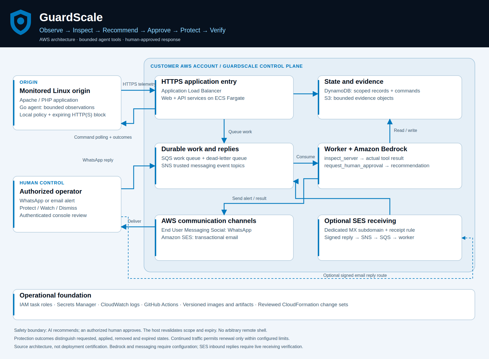
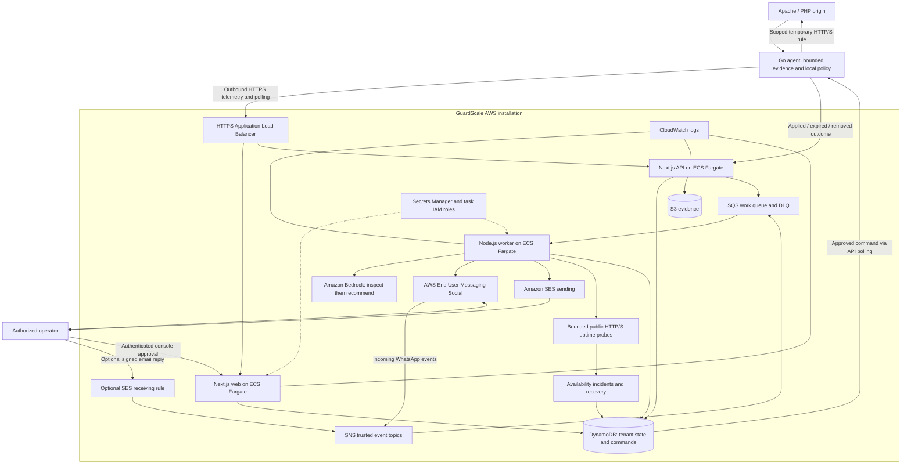

# GuardScale — AWS architecture

[Overview](../README.md) · [Judge's field guide](JUDGES_FIELD_GUIDE.md) · [Technical setup](../README-TECHNICAL.md)

## Deployment and data flow

[Download the branded PDF](guardscale-aws-architecture.pdf) · [PNG](guardscale-aws-architecture.png) · [Editable SVG](guardscale-aws-architecture.svg)

Email receiving is an optional deployable component, not an assertion that it is
active in every installation. A local fixture substitutes DynamoDB Local, ElasticMQ
and S3Mock. It calls real Bedrock/messaging only with explicit configuration.

## Why these services?

| Component | Purpose and tradeoff |
|---|---|
| EUM Social | Real WhatsApp delivery and replies through the registered business sender; registration, session windows and templates remain prerequisites. |
| SES | Transactional email and optional inbound incident replies; domain verification and Region-specific receiving setup are required. |
| Bedrock | Managed model inference with a two-step inspection/recommendation contract; inference failures require human review. |
| Fargate and ALB | Independently deployed web/API/worker containers and HTTPS routing; scaling still needs load tests, capacity settings and queue visibility. |
| SQS and SNS | Durable asynchronous work and event fan-out; separate developer queues avoid competing with production consumers. Handlers must tolerate retries. |
| DynamoDB and S3 | Organization-scoped incident/command state and separate bounded evidence objects. Retention and restore behavior require operational verification. |
| IAM and Secrets Manager | Task permissions and managed billing credentials; monitored hosts do not receive control-plane AWS credentials. |
| CloudWatch | Application, worker and deployment diagnostics; outcome records distinguish request acceptance from actual agent execution. |
| CloudFormation and GitHub Actions | Versioned images, agent artifacts and templates; reviewed change sets make resource replacement and deletion visible. |

## Infrastructure lifecycle

Use the [installation guide](../devops/cloudformation/README.md) and matching
[update procedure](cft-update.md). Standalone and shared-platform templates are
separate choices. Preserve the installed variant's data ownership and stable
session secrets; do not reinstall to add messaging.

Optional email receiving reuses a verified sending domain, adds a dedicated MX
subdomain, SES receipt rule, encrypted SNS topic, SQS subscription and guarded
rule-set activation. It does not create an additional SES identity or replace the
main domain's mail routing. [Receiving parameters and verification](email-replies.md)

## Trust boundaries

Incoming events must match configured SNS topics. A messaging sender must be an
authorized recipient; commands are incident-bound, fresh and constrained by policy.
SES command replies additionally validate receipt verdicts, signed reply aliases
and message structure, and reject attachments and automated replies. Credentials
and signed reply tokens must not appear in public screenshots or traces.

The control plane proposes commands; the host enforces scope and expiry. AI tools
cannot run arbitrary shell commands or grant themselves approval. Optional renewal
is capped and Dismiss cancels further extensions and requests active-rule removal.

See [security model](security-model.md), [Guardian contract](guardian.md) and
[data management](data-management.md). AWS hosting alone is not a security certification.
