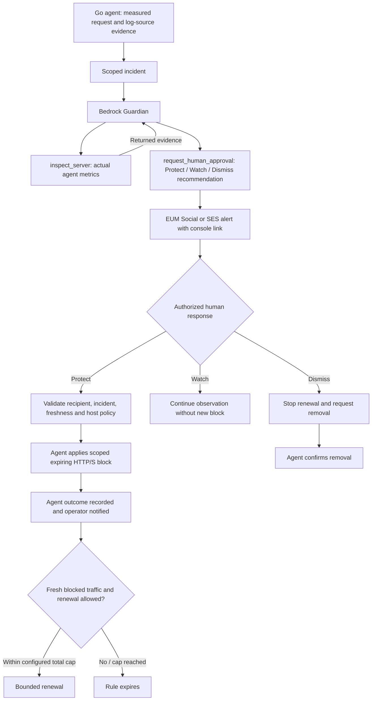

# GuardScale — Judge's field guide and technical report

[Try the application](https://guardscale.org) · [Source](https://github.com/techcto/guardscale) · [Technical setup](../README-TECHNICAL.md) · [AWS architecture](AWS-ARCHITECTURE.md)

## The problem and users

Small operations teams need to understand origin pressure without correlating
several consoles while their application is failing. GuardScale is designed for
operators of Linux web applications: it correlates bounded host observations,
requests additional inspection, explains the evidence and reaches an authorized
human through an existing communication channel.

The intended benefit is a shorter path from detection to informed response.
We have not established a production MTTR improvement, false-positive rate or
fleet-scale capacity benchmark. Source grouping organizes observations; it does
not identify an attacker or establish intent.

## Suggested three-minute walkthrough

[Console screenshots and architecture gallery](gallery/README.md) show actual local
records, saved Guardian tool results and a confirmed protection-removal state.

1. Show the server heartbeat and live sanitized activity in the signed-in console.
2. Generate requests only against the disposable local PHP/Apache fixture.
3. Open the resulting incident and its Guardian tool trace: actual inspection
   precedes the recommendation.
4. Show the delivered WhatsApp alert and reply Protect from the authorized phone.
5. Distinguish the initial acknowledgement from the agent-confirmed applied rule.
6. Show dropped-traffic activity, bounded renewal when enabled, and Dismiss removal
   or natural expiry. Finish with the architecture diagram and limitations.

Use the [local response guide](whatsapp-local-testing.md) for exact setup and the
[technical README](../README-TECHNICAL.md) for installation and checks. Hosted access
uses the reviewer's authorized account, never the fixture password. Provide any
private judging credentials through the submission's private fields.

## Runtime AWS CDS evidence

These integrations are imported **and called**, not merely listed dependencies.

| Service | Runtime code | Entry point / follow-through |
|---|---|---|
| EUM Social WhatsApp | [`AWSNotifier.whatsapp`](../src/lib/notifications.ts) calls `SocialMessagingClient.send(new SendWhatsAppMessageCommand(...))`. | [`processIncident`](../src/lib/incident-workflow.ts) sends alerts; [`worker`](../src/worker/index.ts) routes incoming events to `processWhatsAppEnvelope`. |
| Amazon SES | [`AWSNotifier.email`](../src/lib/notifications.ts) calls `SESv2Client.send(new SendEmailCommand(...))`. | Incident delivery uses the same workflow; optional incoming replies use `processEmailEnvelope` and the [reply validator](../src/lib/email-replies.ts). |
| Amazon Bedrock | [`assessWithGuardian`](../src/lib/guardian.ts) sends `ConverseCommand` and returns actual tool results to the model. | `processIncident` attaches the assessment and trace before notification. |

`GUARDSCALE_NOTIFICATION_MODE=aws` selects real CDS delivery; the default local
LogNotifier explicitly records that nothing was delivered. The lockfile resolves
the AWS SDK clients. Tests using injected dependencies establish contracts, not
live AWS delivery. Provider acceptance IDs alone do not prove inbox delivery or
an applied protection rule.

## Agent workflow and human control



The model is limited to two steps: inspect, then recommend. It is not an unbounded
planner or a shell agent. A failed inspection or malformed tool selection returns
an unavailable assessment and does not authorize protection. Approved commands
are checked again on the monitored host.

A plain Protect reply is accepted only when it identifies exactly one eligible
pending incident for that recipient. Multiple pending alerts require the incident
code or authenticated console selection. Dismiss is a state change plus a removal
request; removal is complete only after the host confirms it.

## Run the application, then choose a test

Start with clone → `.env` → `docker compose up --build -d` as described in the
[technical README](../README-TECHNICAL.md#start-the-main-application). Open
http://localhost using the root password you configured. Then run
`bash test-server.sh start` to enroll the local test website into that same app,
and `bash test-server.sh attack` only when ready to generate test traffic.

The commands below are the separate automated regression lab, not the normal
three-step application/test-server/attack workflow.

```sh
git clone --recurse-submodules https://github.com/techcto/guardscale.git
cd guardscale
npm ci
npm run local:security
npm run local:test:security
```

Requirements: Node.js 26, Docker Linux containers, Compose 2.24.4+ and kernel
iptables/ipset support. Open http://localhost:8185, root / test; the authorized
fixture site is http://localhost:8186. Normal tests deliver no messages.

For live inference and two-way WhatsApp, follow [credential and queue setup](whatsapp-local-testing.md).
Each developer needs an isolated reply queue, approved expiring credentials and
an authorized recipient. Do not consume the production queue locally. The real
response test is `node devops/local/test.mjs --security --bedrock --response` after
that setup. It uses paid AWS services and a real recipient; it is not the default test.

Email sending requires an SES-verified sender. Signed email responses additionally
require the [receiving infrastructure](email-replies.md), valid DNS and a completed
real inbox-to-worker test.

## Evaluation and limitations

The October 27 development session exercised a real disposable PHP/Apache site,
a 60-request test burst, real Bedrock inspection/recommendation, WhatsApp delivery
and inbound approval, and an agent-confirmed temporary block. SES outbound delivery
was separately confirmed by the authorized recipient in their inbox. These are
observations from a development run, not published performance benchmarks.

| Evidence | Reproduction / interpretation |
|---|---|
| Real log ingestion and privacy | [Local Playwright tests](../devops/local/tests.mjs): generated requests reach the enrolled Go agent and console. |
| Block and recovery | [Security tests](../devops/local/security-tests.mjs): real kernel block, expiry and unaffected operator access in an isolated fixture. |
| Messaging and response states | [Response tests](../devops/local/response-tests.mjs) plus [workflow tests](../src/lib/incident-workflow.test.ts): distinguish requested and applied outcomes. |
| AI inspection boundary | [Guardian tests](../src/lib/guardian.test.ts): valid tools, malformed selections, missing configuration and failure behavior. |
| Scoped protection | [Command tests](../src/lib/protection-commands.test.ts) and Go tests: expiry, policy validation and cancellation behavior. |
| Email reply authorization | [Email tests](../src/lib/email-replies.test.ts): stale/spoofed/invalid messages, signed aliases and rejected attachments. Unit tests do not prove deployed receiving. |
| Infrastructure | [Messaging template checks](../devops/cloudformation/messaging.test.cjs) and activation tests cover template contracts; actual change-set deployment remains a separate check. |

The fixture's sample approval uses a 60-second block and a finite renewal cap;
actual deployment policy determines durations. Persistent traffic can trigger
bounded extensions only when configured. Dismiss requests removal and halts
renewals. Distributed attacks, shared NATs, trusted-proxy errors and unavailable
log sources can complicate interpretation. No autonomous identity attribution,
guaranteed attack prevention or calibrated AI accuracy is claimed.

**Deployment distinction:** working source and local/live-provider evidence do not
establish that every hosted feature is enabled. Verify Bedrock configuration,
recipient verification, queue routing and email receiving on the target installation.
At this documentation update, end-to-end SES inbound replies still require live
verification. The hosted model configuration must be checked before an AI demo.

## MCP demonstration

GuardScale also exposes organization-scoped agent tools. Follow the
[Guardian MCP contract](guardian.md) and [hosted MCP documentation](https://guardscale.org/docs/mcp).
Read tools inspect servers, activity and incidents. Response tools dispatch only
an already-approved, unexpired command; an external agent cannot grant itself
approval or obtain arbitrary shell access. Keep bearer credentials private.

## Source and access

- Repository URL: https://github.com/techcto/guardscale (public; no collaborator invitation required).
- Open-source license: [AGPL-3.0-or-later](../LICENSE), with a separate [copyright notice](../NOTICE).
- Technical report: this guide, [technical README](../README-TECHNICAL.md), and [AWS architecture](AWS-ARCHITECTURE.md).
- Diagram sources: the Mermaid diagrams above and [editable deployment diagram](architecture-diagram.mmd).
- Runtime CDS evidence: source call-site table above and the delivered-message demonstration.
- Working endpoint: https://guardscale.org; reviewer access must be supplied and checked.

Never commit real credentials, session files, signed response tokens or private
customer evidence. Optional scanners are confined to authorized targets and retain
their own licenses. The public source includes `.env.example`, not a filled environment.
